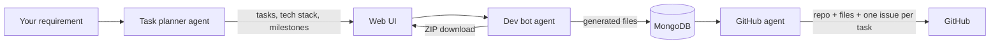

<div align="center">


# Synapse

**Describe a project in plain English. Get a task plan, a tech-stack recommendation and a generated codebase, pushed to GitHub.**

[](LICENSE)
[](https://python.org)
[](https://fastapi.tiangolo.com)
[](https://ai.google.dev)
[](CONTRIBUTING.md)
[](https://synapse-av8e.onrender.com/)

[Live demo](https://synapse-av8e.onrender.com/) · [Quick start](#quick-start) · [How it works](#how-it-works) · [API](#api) · [Roadmap](#roadmap) · [Contributing](#contributing)

</div>

---

## What it does

Synapse is an open-source AI development assistant built with FastAPI and Google Gemini. It chains three agents together:

1. **Task planner:** turns a natural-language requirement ("a REST API for a library with JWT auth") into ordered development tasks, a recommended tech stack and realistic milestones.
2. **Dev bot:** generates a complete project scaffold for those tasks and packages it as a ZIP.
3. **GitHub agent:** creates a repository, pushes the generated files and opens one GitHub issue per task.

The browser UI is plain HTML, CSS and JavaScript, so there's no build step and it's easy to hack on.

> **Note on the live demo:** it runs on a free Render instance, so the first request after a period of inactivity can take about 30 seconds while it wakes up.

## Quick start

**Requirements:** Python 3.10+, a [Google Gemini API key](https://aistudio.google.com/app/apikey), and MongoDB (local or [Atlas](https://www.mongodb.com/atlas)). A GitHub token is optional and only needed for pushing.

```bash
git clone https://github.com/skdas20/Synapse.git
cd Synapse
python -m venv .venv && source .venv/bin/activate   # Windows: .venv\Scripts\activate
pip install -r requirements.txt

cp .env.example .env    # then fill in GEMINI_API_KEY and MONGODB_URI

uvicorn app:app --app-dir backend --reload --port 8000
```

Open <http://localhost:8000>. Interactive API docs are at <http://localhost:8000/docs>.

### Environment variables

| Variable | Required | Purpose |
| --- | --- | --- |
| `GEMINI_API_KEY` | Yes | Task planning and code generation |
| `GEMINI_MODEL` | No | Gemini model for planning and code generation (default `gemini-2.5-flash`) |
| `MONGODB_URI` | Yes, for pushing to GitHub | Stores generated projects between steps |
| `GITHUB_TOKEN` | No | Default token for the GitHub agent (`repo` scope). Users can also paste a token in the UI. |

Never commit your `.env` file.

## How it works



| Component | File |
| --- | --- |
| FastAPI app and routes | `backend/app.py` |
| Task planning (Gemini) | `backend/agents/task_planner.py` |
| Code generation (Gemini) | `backend/agents/dev_bot.py` |
| GitHub integration (PyGithub) | `backend/agents/github_agent.py` |
| Web UI | `index.html`, `styles.css`, `script.js` |

## API

| Method | Endpoint | Description |
| --- | --- | --- |
| `GET` | `/health` | Status of MongoDB, Gemini and GitHub services |
| `POST` | `/api/process-requirement` | Requirement → tasks, tech stack and goals |
| `POST` | `/api/generate-code` | Tasks → generated project: stored for pushing, returned as a ZIP (used by the UI) |
| `POST` | `/api/generate-project` | Tasks → generated project ZIP only |
| `POST` | `/api/push-to-github` | Create a repo, push the latest generated project and open issues |
| `POST` | `/api/update-github-token` | Set the GitHub token used for pushing |

Request and response examples are in [docs/API.md](docs/API.md).

## Deploying

The included `Procfile` works on Render, Railway and Heroku-style platforms:

```
web: uvicorn app:app --app-dir backend --host 0.0.0.0 --port $PORT
```

Set `GEMINI_API_KEY`, `MONGODB_URI` and, optionally, `GITHUB_TOKEN` in the platform's environment settings.

> ⚠️ **Single-user for now.** The GitHub token and the "latest generated project" are shared server-wide, so a public multi-user deployment can push one visitor's project with another visitor's token. Deploy it for yourself or your team until per-session isolation lands ([roadmap](#roadmap)).

## Roadmap

- [ ] Per-session isolation of GitHub tokens and generated projects
- [ ] Update to a current Gemini model, and make the model configurable
- [ ] Stream generation progress to the UI
- [ ] Support more LLM providers (OpenAI-compatible APIs, Ollama for local models)
- [ ] Tests and CI for the agents, with the LLM mocked
- [ ] Preview generated files in the browser before pushing
- [ ] Docker image and `docker compose` setup

## Contributing

Synapse is a friendly place for a first open-source contribution: Python, prompt engineering, frontend or docs. See [CONTRIBUTING.md](CONTRIBUTING.md) and pick an issue labelled [`good first issue`](https://github.com/skdas20/Synapse/labels/good%20first%20issue).

If Synapse saves you time, **please ⭐ the repo**; it helps more people find it.

## License

[MIT](LICENSE) © Sumit Kumar Das
